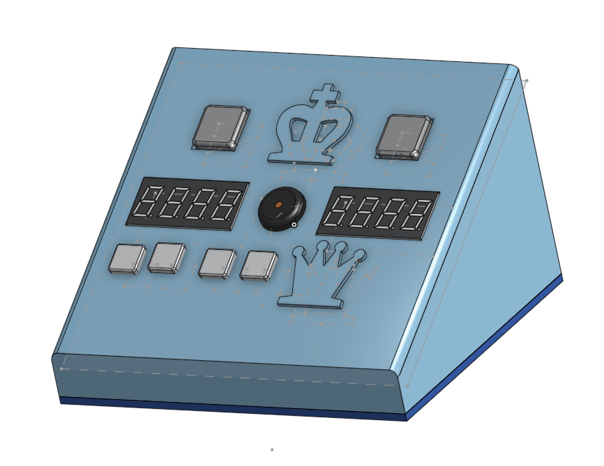
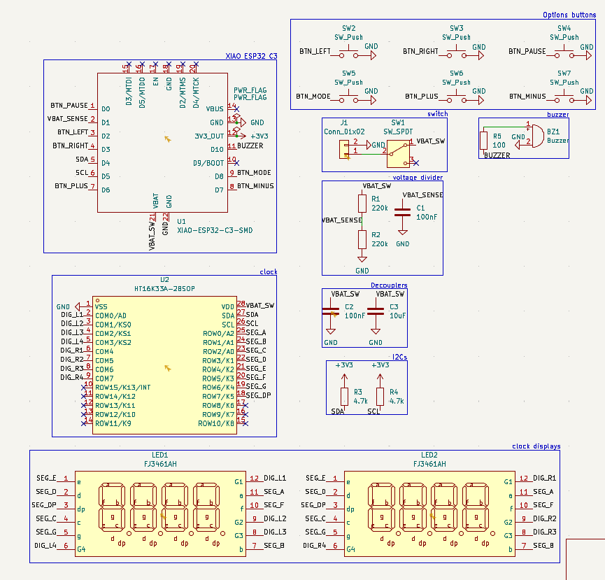
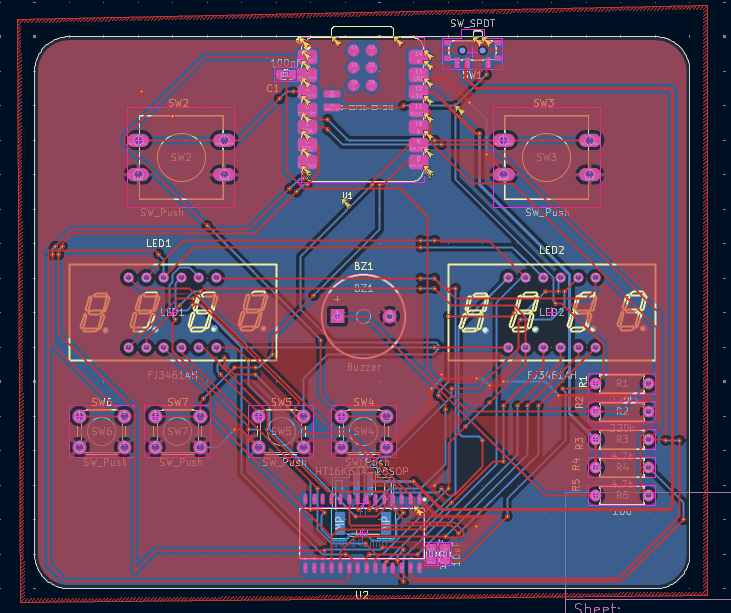
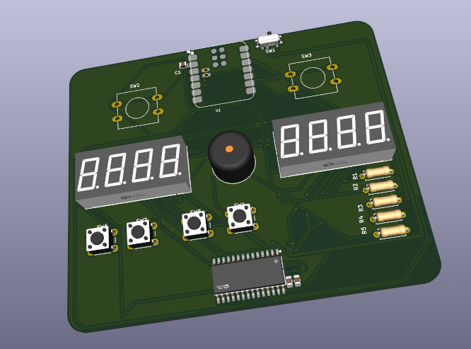
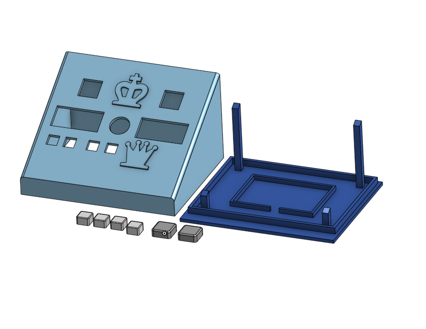

# Chess Clock

## Overview

If anyone has been looking at my [Github Profile](https://github.com/vincentchen18), they may be quite aware of my active participation in the sport of chess. Hence, this project would seem fairly derivative. 

This project is an addition to my already existing chess projects, which includes:

- [My chess engine project](https://github.com/vincentchen18/chess-engine), a roughly 1700 rated chess bot made from pygame

- [My 3D chess set model](https://github.com/vincentchen18/board-game-set), a printable chessboard with which this clock is designed to go with.

This project includes a printed circuit board, as well as a 3D modelled chess clock shell designed to fit the PCB, complete with button caps.

The clock is also noticeably quite small. (pcb size < 100mm x 100mm). Yes, the player buttons are quite sketchy and diagonal. This is because they are angled with the PCB

This project is also built for week 4, displays, of Hack Club's [Half Life YSWS](halflife.hackclub.com) program.

## Schematics

Above is the schematics for this chess clock project, made in KiCad. The project includes a XIAO-ESP32-C3, 2 four 7segment digit displays, as well as a bunch of switches/buttons and resistors.

The Printed Circuit Board layout is below.

## Hardware & Assembly

This is the PCB render of my project.

The keys/switches need to be stuck onto the switch parts.

Then, the case for the chess clock must be printed.

Then, to assemble the final Chess Clock, you first need to complete assembly of the PCB, then, attach the buttons and the keycaps from the 3D print file, located [here](3D%20Models/Printing%20Assembly.stl), which needs to be printed.

After attaching the keycaps, place the PCB inside the top print, ensuring that the buttons go in the correct holes and that displays poke through and can be seen. Also ensure that you can access the switch and the USB plug from the back of the case, as the clock requires that hole for charging.

Finally, place the bottom piece into the top piece, (there is around 0.2mm of tolerance), and it should friction fit on, holding the pcb in place.

That's it!! just push the firmware code into the pcb and it's done.

## Features and Controls

** Please note that the clock is not configured to be able to set uneven time intervals (so no time odds :C). It is not recommended that you challenge a master using this clock (if you're an unskilled player like me of course)**

This clock features: 

- 10 time control presets, as well as custom adjustable time controls using the 4 buttons.

- Fischer, Bronstein, and Delay increment modes

- Turn indicator: a dot lights up the player whose time is currently running.

- Time Scramble Mode and Low Time Warning: switches to display seconds and partial seconds when you are low on time, and beeps the buzzer to tell you that you're low on time when your clock reaches <10s.

- Move counter, which is shown while the clock is paused. (most clocks don't have this :DDD)

- Buzzer beeps for each move and also when someone flags, as well as low time warning, which is optionally mutable.

- LiPo Power with USB-C Charging through the XIAOESP32C3

- Battery Voltage on boot, low battery warning, and autoshutdown if battery is too low (remember to charge your clock! :33)

- Autosleep when idle for too long

- Settings saved across power off.

### Setup Menu

The setup menu in my clock is a bit unconventional compared to other clocks. Since both players' times are always equal, the left display shows the time in minutes, while the display on the right shows the increment type and the increment amount.

Other controls:

| Button | State | Action |
|---|---|---|
| Left / Right | Ready | Start the **other** player's clock |
| Left / Right | Your turn | End your turn, start your opponent's |
| Left / Right | Asleep | Wake the clock |
| Pause (tap) | Running | Pause — displays alternate time / move count |
| Pause (tap) | Paused | Resume |
| Pause (hold 1 s) | Any (except setup) | Reset both clocks |
| Mode (tap) | Ready / Flagged | Enter setup |
| − (hold 1 s) | Ready | Toggle sound on / off |
| Mode (tap) | Setup | Next field: preset → base time → increment → type |
| + / − | Setup | Change the blinking value |
| Pause (tap) | Setup | Save and exit |

From left to right, the buttons are +, -, mode, and pause.

That's it! :DD

## AI Usage

AI was not used during the entirety of the creation of this project.